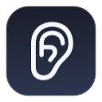

<p align="center">
  
</p>

<h1 align="center">PsychAudio</h1>

<p align="center">
  Deterministic hardware media key routing for macOS, eliminating play/pause race conditions between Apple Music and Google Chrome.
</p>

---

## Overview

On macOS, pressing the hardware Play/Pause media key often leads to unpredictable behavior: the system daemon (`mediaremoted`) guesses which application should receive the event, frequently triggering Apple Music when a user intends to resume a paused YouTube video or podcast in Google Chrome, or vice versa.

**PsychAudio** solves this through a lightweight, two-part architecture:

1. **Native Menu Bar Daemon (Swift)**: Runs as an accessory app in the macOS menu bar. It provides universal media control by intercepting both physical keyboard media keys (via low-level HID `CGEventTap`) and external audio peripherals such as Bluetooth headphones, AirPods, and external controllers (via `MPRemoteCommandCenter` and `MPNowPlayingInfoCenter`). A minimal, zero-overhead silent CoreAudio output engine keeps the daemon registered as an eligible media destination without requesting microphone access or showing recording indicators. The daemon tracks playback states between Apple Music and Chrome tabs, deterministically routing play/pause commands to the source that was playing or most recently paused.
2. **Chrome Extension (Manifest V3)**: Bridges Chrome tab audio states (`audible: true/false`) to the native daemon over a strictly local WebSocket server and executes targeted play/pause toggles inside the active media tab.

---

## Universal Media Control

PsychAudio v1.1.0 provides end-to-end media key arbitration across all input sources:

* **Built-in & External Keyboards**: Intercepts physical Play/Pause hardware keystrokes (`NX_KEYTYPE_PLAY`) at the HID event tap level, consuming the event so macOS system daemons cannot guess the target.
* **Bluetooth Headphones & AirPods**: Handles AVRCP media commands (single/double stem squeezes, button clicks) through `MediaPlayer.framework`.
* **Zero Microphone Usage**: Runs a silent output-only audio session. It does not access input devices, never requests microphone permissions, and never displays macOS recording indicators.

---

## Setup Instructions

### 1. Build and Install the Native Application

1. Open Terminal in the repository root and run the build script:
   ```bash
   ./build.sh
   ```
2. Copy the resulting application bundle to your `/Applications` directory:
   ```bash
   cp -R dist/PsychAudio.app /Applications/
   ```
3. Launch the application:
   ```bash
   open /Applications/PsychAudio.app
   ```
   An ear icon will appear in the macOS menu bar.

### 2. Grant macOS Permissions

* **Accessibility**: Required for the low-level HID event tap to intercept physical keyboard media keys.
  * Open **System Settings > Privacy & Security > Accessibility**.
  * Ensure **PsychAudio** is toggled **ON**.
* **Automation**: Required for AppleScript to control Apple Music playback.
  * When PsychAudio first routes a command to Apple Music, macOS will display an authorization prompt. Click **Allow** (or verify under **System Settings > Privacy & Security > Automation > PsychAudio > Music**).

### 3. Install the Chrome Extension

1. Open Google Chrome and navigate to:
   ```
   chrome://extensions
   ```
2. Enable **Developer mode** using the toggle in the upper-right corner.
3. Click the **Load unpacked** button in the upper-left toolbar.
4. In the file picker, select the `chrome-extension` directory from this repository.
5. The **PsychAudio** extension is now active and will automatically connect to the local daemon.

---

## Privacy & Security

* **Strictly Local**: The daemon binds its WebSocket server exclusively to `127.0.0.1` on port `49281`. It rejects any non-loopback connections.
* **No Telemetry**: Neither the native daemon nor the Chrome extension transmits analytics, metrics, or personal data. No external servers or cloud services are involved.

---

## License

This project is licensed under the [MIT License](LICENSE).
